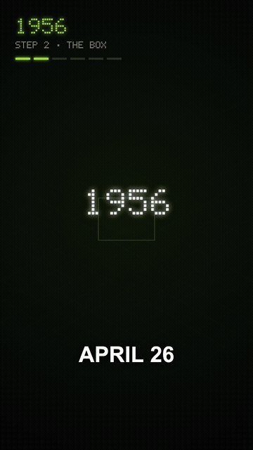
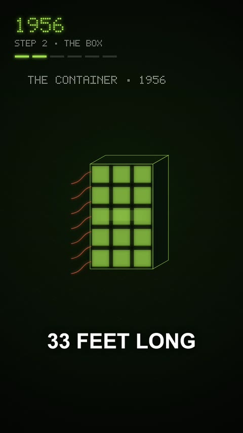
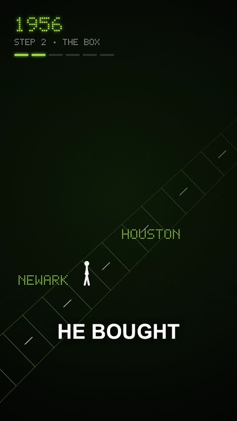
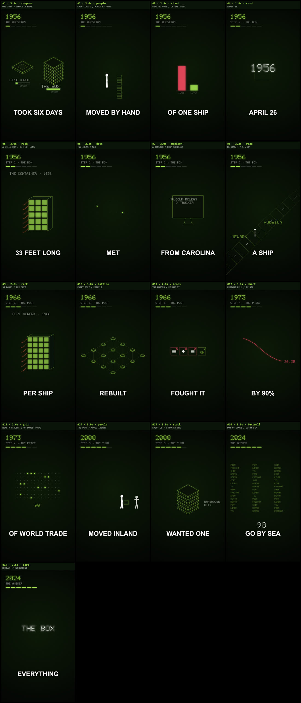

# wireframe-explainer

**An agent skill that renders an explainer video on any topic in one fixed visual style** — near-black canvas, lime isometric wireframe diagrams, dot-matrix HUD, bold two-word captions. Code-drawn frame by frame: no footage, no video model, no API keys.

<p align="center"></p>

```bash
# in any project, with an agent that can run commands:
Install https://github.com/akosiraffytot/wireframe-explainer, then make a 60s video about <topic>
```

---

## What it makes

A 9:16, 30 fps explainer built from one JSON storyboard. Every shot is a single
idea drawn as an isometric diagram, with a caption that advances line by line
inside the shot.

| | | |
|---|---|---|
|  |  |  |

Fully rendered example: [`media/containers.mp4`](media/containers.mp4) — 17 shots, 48.8 s,
made from [`examples/containers.film.json`](examples/containers.film.json).

## Install

```bash
git clone https://github.com/akosiraffytot/wireframe-explainer /tmp/wireframe-explainer
bash /tmp/wireframe-explainer/scripts/install.sh .     # -> ./.agents/skills/wireframe-explainer
```

The installer checks `node` (18+) and `ffmpeg`, copies the skill into your project,
and warms its one native dependency (`@napi-rs/canvas`, installed automatically on
first run — no project-level npm setup).

Manual install: copy `SKILL.md`, `reference.md`, `render.mjs`, `lib/`, `examples/`,
`package.json` into `./.agents/skills/wireframe-explainer/`.

## Use

```bash
cd .agents/skills/wireframe-explainer
node render.mjs examples/containers.film.json out/containers.mp4   # render the demo
node render.mjs my.film.json --stills --outdir stills              # QA stills, one per shot
node render.mjs my.film.json --sheet --outdir stills               # approval sheet: one frame per shot
node render.mjs my.film.json out/film.mp4 --music bed.mp3          # with a music bed
node build.mjs out/film.mp4 act1.json act2.json --parts 8          # long film, parts + concat
```

Rendering runs at ~24 frames per second, so a 3-minute film takes about 4 minutes.

### film.json

```json
{
  "size": [720, 1280], "fps": 30,
  "chapters": [{ "badge": "1956", "label": "THE QUESTION", "step": 1, "of": 6 }],
  "shots": [
    {
      "ch": 0,
      "tpl": "compare",
      "dur": 3.2,
      "props": { "labels": ["LOOSE CARGO", "THE BOX"], "meters": [0.14, 0.95] },
      "lines": ["ONE SHIP", "TOOK SIX DAYS"]
    }
  ]
}
```

Captions take keywords: `{"text": "SO HE CHOSE SPEED", "hi": ["SPEED"]}` paints
`SPEED` lime. `\n` makes a two-row block. Full schema in [`SKILL.md`](SKILL.md).

## The review gate

The agent plans first and renders second. Phase A ends with a table in
`storyboard.md` **and** a labelled contact sheet — one frame per shot — that you
approve before any video is encoded:

<p align="center"></p>

```bash
node render.mjs my.film.json --sheet --outdir stills    # -> stills/storyboard.png
```

## Templates

| | |
|---|---|
| `compare` two objects, labels, meters, optional red slash / ban plane | `chip` one die with callouts, rings or rays |
| `stack` layers assembling bottom-up | `grid` dense dot field, a few lit, counter |
| `chart` bars or a falling line | `road` converging road with a walker and place tags |
| `pixels` pixel matrix with a sweep bar | `lattice` isometric lattice of chips with links |
| `rack` cabinet of GPUs with cable curves | `icons` icon row with ticks and crosses |
| `monitor` CRT with typed screen text | `textwall` wall of dot-matrix words + big number |
| `people` stick figures: queue, crowd, hand-off | `dots` sparse field, a few lit (headcount, survivors) |
| `card` a beat with a big dot-matrix word | + shot-level `annot`, `big`, `fade`, `enter` |
| `compose` any of 20 primitives (`chip`, `arrow`, `badge`, `bars`, `callout`, `counter`, `lattice`, …) in any arrangement | for shots no fixed template covers |

The catalog with every prop, plus the measured style spec (shot length, caption
timing, palette, type sizes), is in [`reference.md`](reference.md).

## How it works

- `lib/dotfont.mjs` — a 5×7 dot-matrix type engine (no font files, uppercase Latin).
- `lib/draw.mjs` — palette, isometric grid, glowing wireframe chip / stack / rack / road / rings, stick figure.
- `lib/scenes.mjs` — the 15 fixed templates + `compose`, the HUD, and the caption engine (line timing, keyword colouring, entrance).
- `lib/primitives.mjs` — the 20 scene primitives a composed shot is built from.
- `render.mjs` — walks `film.json`, draws each frame with Skia, pipes raw frames to `ffmpeg`.
- `lib/load-canvas.mjs` — finds `@napi-rs/canvas` wherever it is and installs it once if it is nowhere.

## Requirements

`node` 18+ · `ffmpeg` on PATH · a font that resolves from `Arial` / `Helvetica Neue` / `Liberation Sans` (all covered by the caption font stack).

## Notes and limits

- The style was reverse-engineered with [rea-video](https://github.com/JuneYaooo/rea-video) from a 178 s reference breakdown: 65 shots, 2.74 s mean shot length, 1.2 s median caption line, 100% code-rendered.
- **The demo is a shape, never a script.** The agent must write a `storyboard.md` from your brief before touching JSON, and `check.mjs` fails any film whose shots or captions are lifted from `examples/containers.film.json`. Content quality is still on the agent: the style is guaranteed, the script is not.
- Diagrams are template-bound. A topic that needs a genuinely new visual means editing `lib/scenes.mjs`.
- Dot-matrix text is uppercase Latin + digits only. Captions take accents; CJK does not.

## License

MIT — see [LICENSE](LICENSE).
